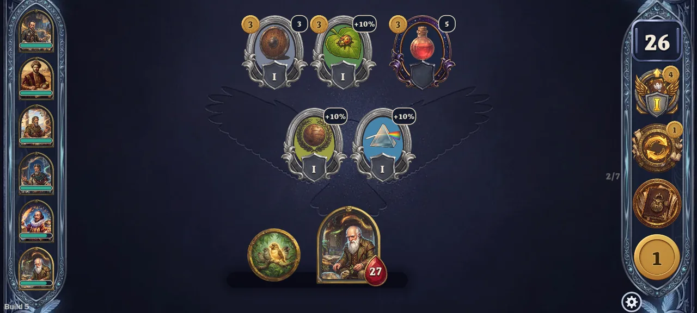
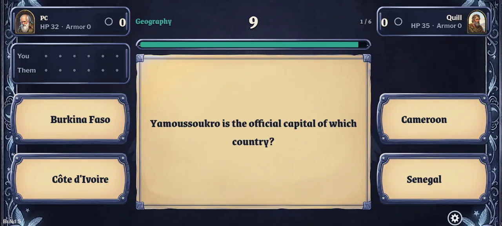
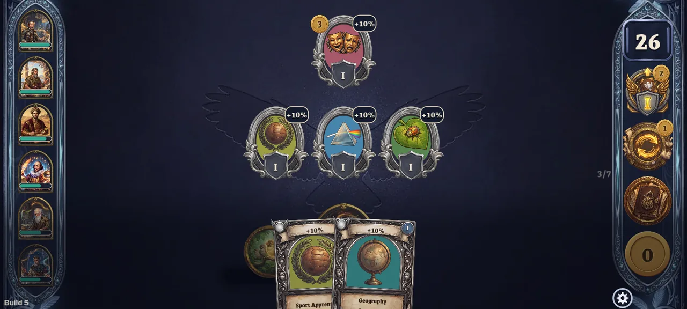
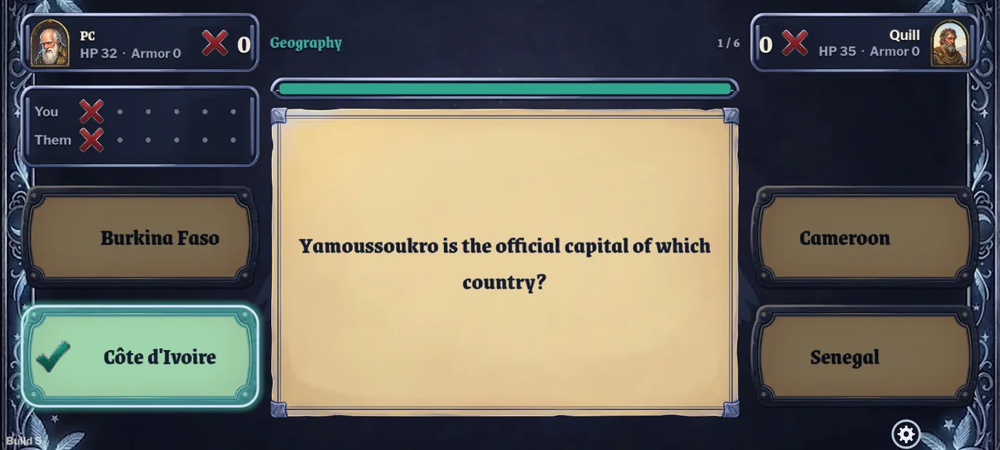
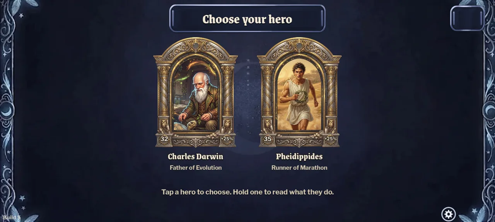
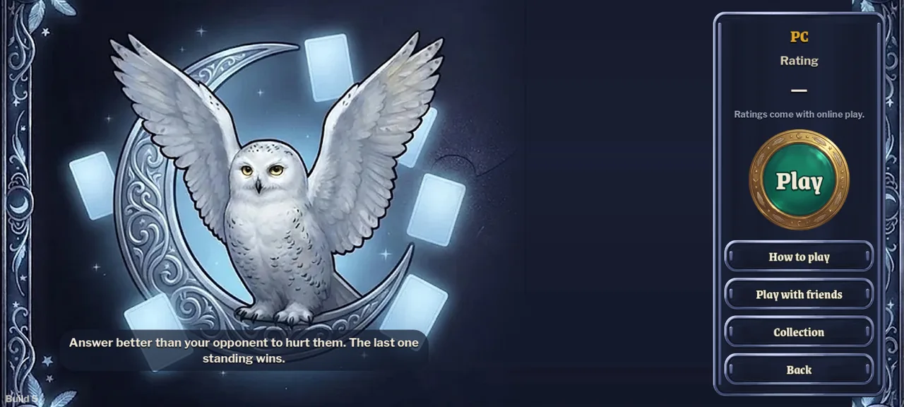

# Owl

An auto-battler built on general knowledge. Up to six players share a lobby. Each round they buy cards in a shop and place them on a board; then they meet one opponent over six multiple-choice questions. Answer more of them right and you deal the damage. The last player standing wins.

Cards bend a battle: they pull questions toward the categories you know, add answer time, armor, damage or reflect, and make questions easier or harder. Ten categories, twelve heroes from history, about a thousand questions.

Play offline against bots, or online with friends in a lobby joined by code.

The game is inspired by Hearthstone Battlegrounds: the shop, the tavern tiers and the board come from that genre, and the battles are fought with questions instead of minions.

  
  

  
  

  
  

## What is here

| Part | What it is |
|---|---|
| `crates/core` | Every game rule, in pure, deterministic Rust: commands in, events out. |
| `crates/lobby` | Runs one match: timers, bots, ghosts, what each player may see, the question bank. |
| `crates/local` | A Godot extension that hosts a lobby inside the app, for offline play. |
| `crates/server` | The online server (Axum, WebSocket, SQLite): accounts, friends, lobbies, the download page. |
| `crates/protocol` | The messages between the game and a host. |
| `crates/sim` | Plays thousands of bot matches, to tune the numbers. |
| `crates/release` | Signs and checks the game's self-updates. |
| `client` | The Godot 4 game. It draws the state and holds no rules. |
| `data` | Cards, heroes, numbers (`tunables.toml`) and questions, as TOML files. |
| `deploy` | Docker and a Cloudflare tunnel, to run the server on a small machine such as a Raspberry Pi. |

`ARCHITECTURE.md` says how it fits together. The rules are in `CLAUDE.md`, the heroes in `HEROES.md` and the cards in `CARDS.md`. `docs/` holds the protocol, the server guide, the question format and the privacy notice.

## Running it

You need Rust (stable) and Godot 4.7.

- Tests: `cargo test --workspace --exclude owl-local`
- Simulator: `cargo run --release -p owl-sim -- --lobbies 1000`
- The game on Windows: `play.bat` builds the extension and opens the game in a phone-shaped window. Elsewhere, run `cargo build -p owl-local` and open `client/` in Godot.
- A server for your own network: `server.bat`, or `cargo run -p owl-server` (settings in `docs/server.md`).
- Android: `android.bat`, after creating `android.local.bat` with your signing key (see the top of `android.bat`).

## Not included

- **Sound.** The game's music and effects are licensed for use in the game but not for redistribution, so they are not in this repository. The game runs silently without them; put your own files in `client/assets/sound/` under the names in `client/scripts/sound.gd`.
- **The release key.** Self-updates are signed. `crates/release/release.pub` is empty here, so a build from this repository trusts no downloaded update. To publish your own updates, make a key with `cargo run -p owl-release -- keygen --pub crates/release/release.pub` (see `docs/server.md`).

## Questions

Every question was written for this game from facts in published quizzes with answer keys, and each answer was checked against a second reference. Both links are in the question's entry. Most have not yet been reviewed by a person (`reviewed = false`); corrections are welcome.

## Licence

The code is under the MIT licence (`LICENSE`). The pictures, card and hero texts and the questions are under CC BY 4.0 (`LICENSE-ASSETS.md`). The fonts are under the SIL Open Font License; their licences sit beside them in `client/assets/fonts/`.

Owl is a fan-made, independent project. It is not affiliated with, endorsed by or sponsored by Blizzard Entertainment. Hearthstone and Hearthstone Battlegrounds are trademarks of Blizzard Entertainment, Inc. No Blizzard art, sound or code is used.
